

# Zabbix MCP Agent

**Conversa con tu Zabbix: un agente de IA que investiga, propone y actúa con tu aprobación, usando el servidor MCP nativo.**

Español · [English](README.md)

**[🚀 Instalar paso a paso](docs/guia-ubuntu-paso-a-paso.md)** · [Qué hace](#qué-hace) · [Cómo funciona](#cómo-funciona) · [Seguridad](#seguridad) · [Qué se comprobó](#qué-se-comprobó)

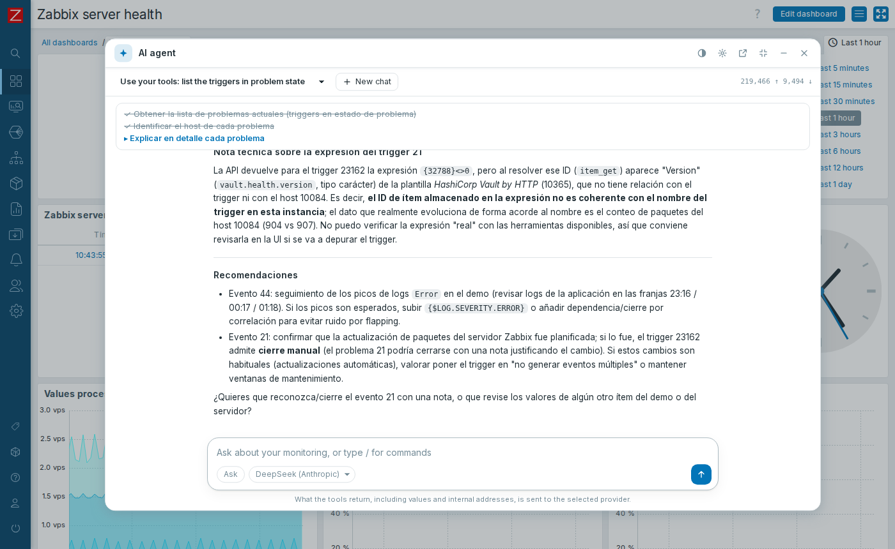

Un módulo de frontend para Zabbix 8 que agrega un chat agéntico **flotante en todas las páginas**: un botón en la esquina lo abre minimizado, normal o amplio, y sigue abierto y trabajando mientras cambias de sección. Trabaja con los permisos de cada usuario y funciona con cualquier proveedor compatible con OpenAI o con Anthropic (Claude).

> [!WARNING]
> **Versión temprana.** Depende de Zabbix 8.0.0rc3, una versión candidata. Lo que devuelven las herramientas se envía al proveedor de IA que elijas.

## 🚀 Instálalo paso a paso

> [!IMPORTANT]
> ### [Abrir la guía: agente de IA para Zabbix 8 en Ubuntu →](docs/guia-ubuntu-paso-a-paso.md)
>
> Instala el servidor MCP y el módulo, conecta un proveedor y comprueba las aprobaciones, con los comandos ejecutados y los problemas encontrados. También en [inglés](docs/ubuntu-step-by-step.md).

| Paso | Qué haces | Cómo sabes que funcionó |
|---|---|---|
| **1-3** | Instalas y configuras el servidor MCP oficial | `---- MCP server is working` |
| **4** | Instalas y habilitas el módulo | Aparece el botón del chat en la esquina inferior derecha |
| **5** | Conectas tu proveedor de IA | `It works: <modelo>` |
| **6** | Pruebas el agente y las aprobaciones | Un rechazo no cambia nada; lo aprobado queda auditado |

## Qué hace

| Función | Detalle |
|---|---|
| **Siempre a mano** | Botón flotante en todas las páginas. **Minimizado**, **normal** o **amplio**, y `Ctrl+.` para abrirlo o cerrarlo |
| **Sigue al navegar** | Cambia de sección o de módulo: el chat queda como estaba, y una respuesta en curso continúa en la página siguiente |
| **Varias pestañas** | Una pestaña ejecuta el agente; las demás lo siguen en vivo y pueden detenerlo |
| **Colores de Zabbix** | Sigue el tema de cada usuario, en los 7 temas, y tiene su propio botón claro/oscuro |
| **Investiga por su cuenta** | Encadena herramientas: problemas, hosts, triggers, ítems e historial |
| **Pide aprobación** | Muestra qué va a cambiar, y solo lo hace si lo permites |
| **Tres modos** | *Preguntar*, *Plan* (solo lectura) y *Auto*. Se alternan con `Shift+Tab` |
| **Muestra su trabajo** | Respuesta en streaming, razonamiento, llamadas plegables y lista de tareas |
| **Te pregunta** | Si necesita una decisión, espera tu respuesta |
| **Se controla como una terminal** | `/help`, `/clear`, `/compact`, `/mode`, `/model`, `/tools`, `/sessions`, `/forget` y **Stop** |
| **Gestiona el contexto** | Resume la conversación al acercarse al límite |
| **Varios proveedores** | Perfiles OpenAI-compatible y Anthropic-compatible, y cambio entre ellos |

| Normal, junto a Zabbix | Minimizado | Tema oscuro |
|---|---|---|
| 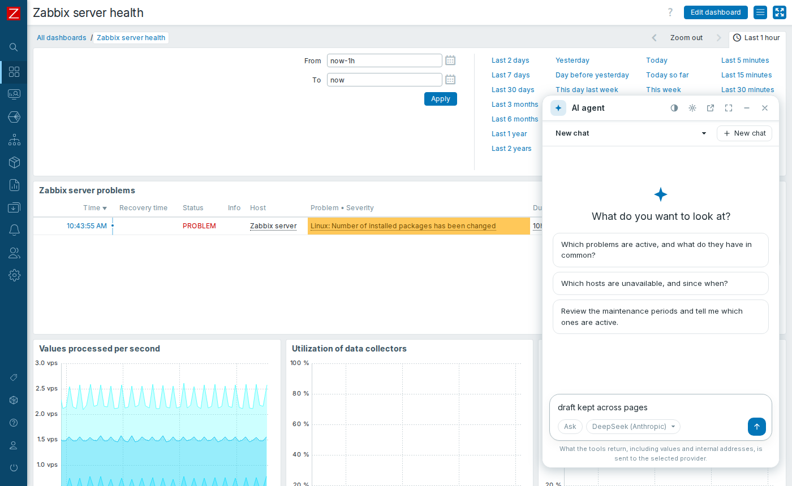 | 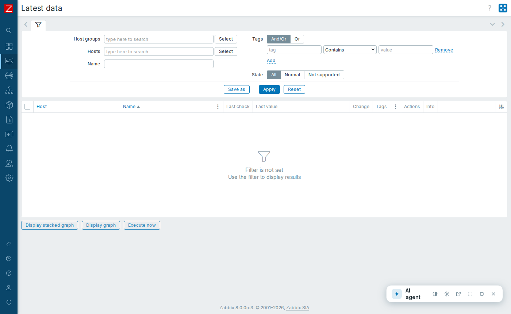 | 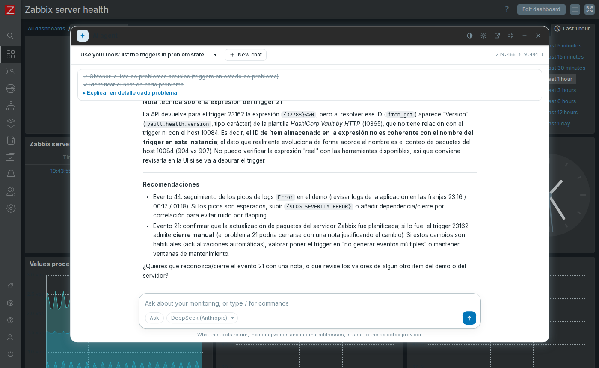 |
| **Tema Dark blue** | **Alto contraste oscuro** | **En español** |
| 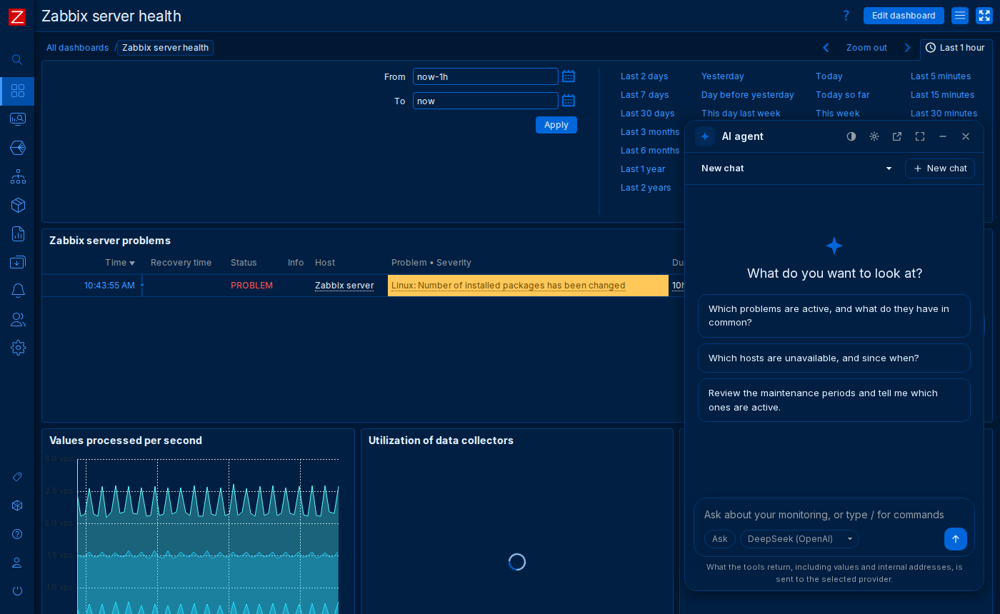 | 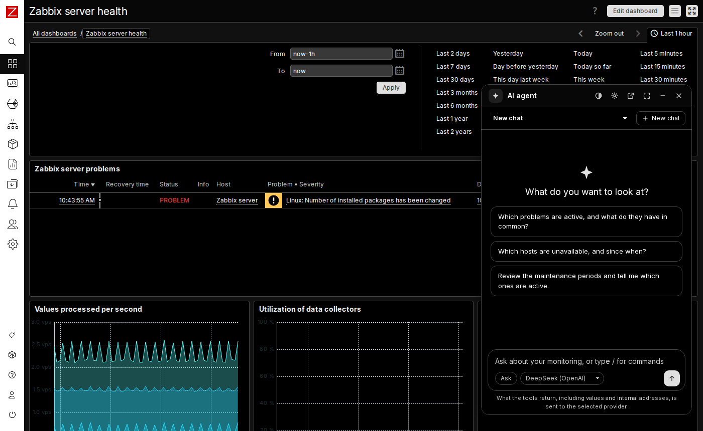 | 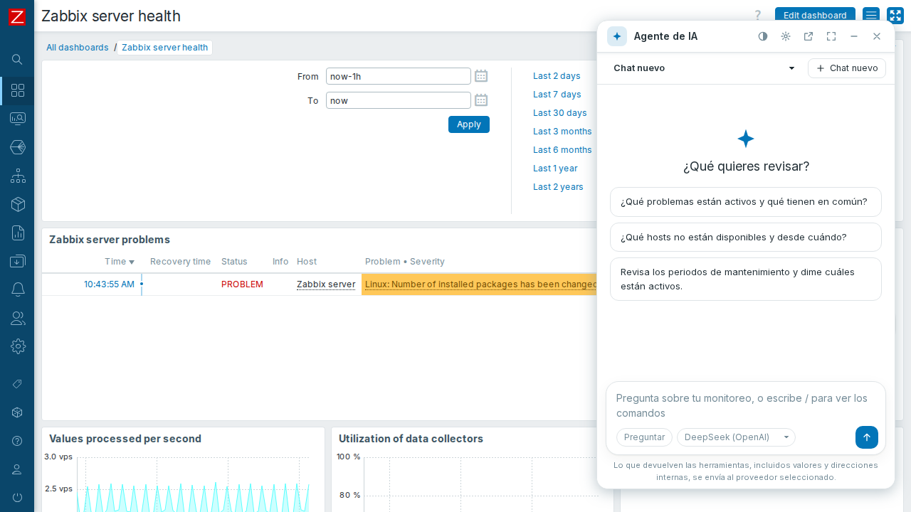 |
| **Otra pestaña lo sigue en vivo** | **Esperando tu aprobación** | **Teléfono** |
| 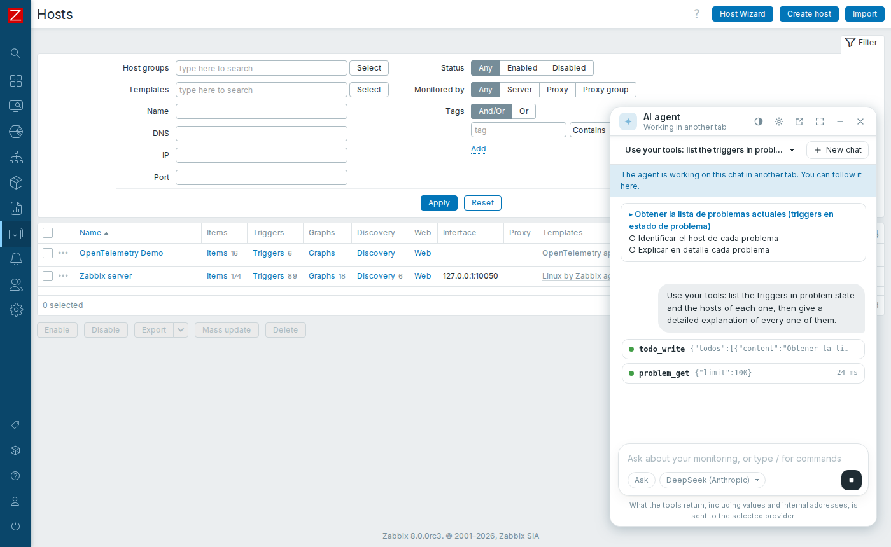 | 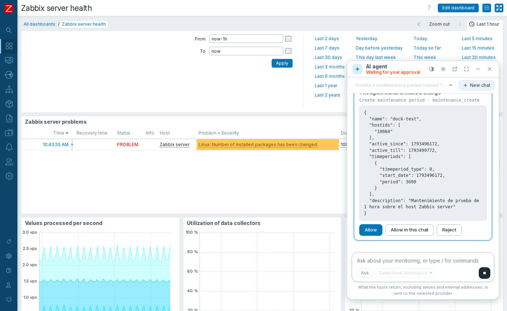 | 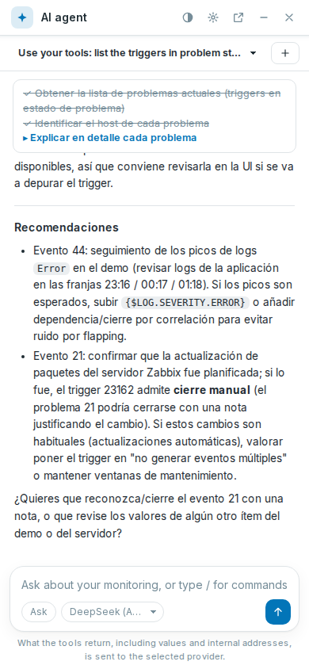 |

**Herramientas del servidor MCP:** 12 de lectura y 10 de cambio: reconocer, comentar, cambiar severidad, suprimir o cerrar problemas, y crear, editar o borrar mantenimientos.

## Cómo funciona

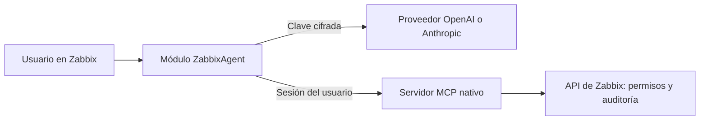

El navegador conduce el bucle del agente, y el servidor del módulo hace de intermediario con el proveedor y con MCP. La [guía](docs/guia-ubuntu-paso-a-paso.md#cómo-funciona) lo detalla.

## Seguridad

- **Sin token compartido:** cada usuario actúa con su sesión. Solo ve lo que Zabbix le permite, y los cambios se auditan a su nombre.
- **Aprobación en el servidor:** una herramienta que no se declare de solo lectura no corre sin aprobación, ni nunca en modo plan.
- **Claves cifradas:** AES-256-GCM, con la llave fuera del web root. Nunca llegan al navegador.
- **Contenido no ejecutable:** todo el texto se escapa antes de mostrarse.

Lee los [riesgos y responsabilidades](docs/guia-ubuntu-paso-a-paso.md#seguridad), sobre todo qué datos se envían a la IA y la inyección de prompts.

## Qué se comprobó

| Prueba | Resultado |
|---|---|
| Guía ejecutada con sus propios comandos | Ubuntu 26.10 ARM64, Zabbix 8.0.0rc3 compilado desde fuente |
| Conversaciones reales | DeepSeek en sus API compatibles con OpenAI y con Anthropic, con datos reales |
| Navegador real (Chromium) | Streaming, herramientas, aprobar y rechazar, plan, detener, `/compact`, móvil y un intento de inyectar HTML |
| Chat flotante (Chromium) | Tres tamaños, `Ctrl+.` y `Esc`; sigue abierto entre secciones; una respuesta continúa tras cambiar de página; una aprobación vuelve tras cambiar de página y un rechazo no cambia nada; una segunda pestaña lo sigue en solo lectura y lo retoma al cerrar la primera; teléfono; sin chat en modo kiosco; los 7 temas y el botón claro/oscuro; textos en español sin cortar; panel amplio junto a la barra lateral |
| Permisos | Un usuario sin acceso recibe el error de la API, y no puede abrir los ajustes |
| Tests y CI | Conversión de mensajes, streams, cifrado y traducciones |

> [!NOTE]
> **Sin comprobar:** AMD64, Ubuntu 26.04, Zabbix por paquetes, Apache, y las API propias de OpenAI y Anthropic. Los temas se probaron cambiando el tema en el HTML que envía Zabbix, no en el perfil del usuario, y los textos en español cargando su catálogo en el chat. No se probó en Safari. El chat flotante se probó con sus archivos nuevos y `agent.config` servidos desde la copia de trabajo, antes de instalarlos en el servidor.

## Qué incluye

| Ruta | Qué es |
|---|---|
| `modules/ZabbixAgent` | El módulo |
| `scripts/install.sh`, `scripts/enable-module.py` | Instalan y habilitan el módulo |
| `scripts/verify-mcp.py` | Comprueba el servidor MCP |
| `tests/run.php` | Tests que no necesitan Zabbix |

## Licencia

[AGPL-3.0](LICENSE), la licencia de Zabbix. © Simon Alex Rodriguez.
