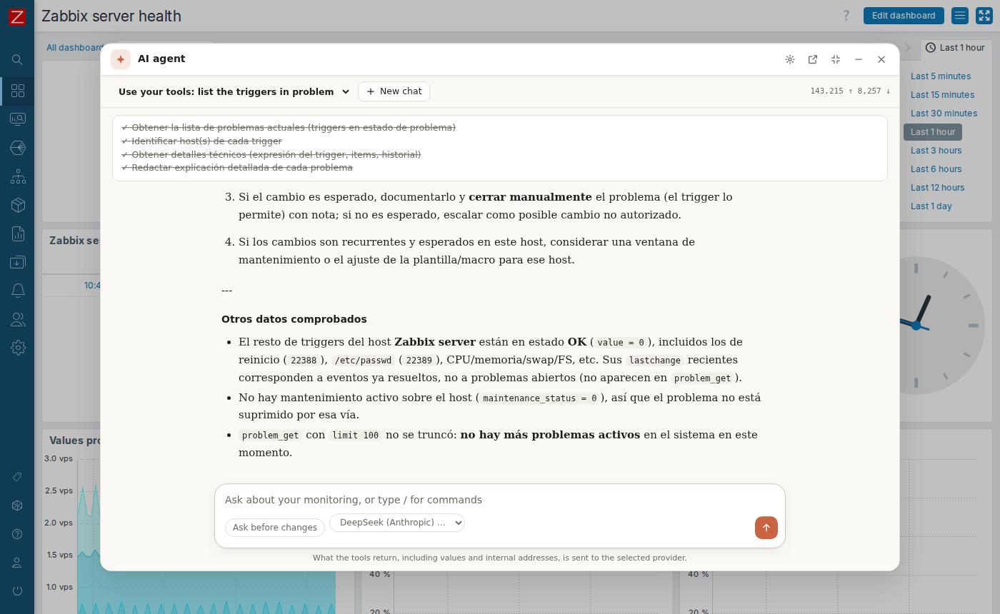
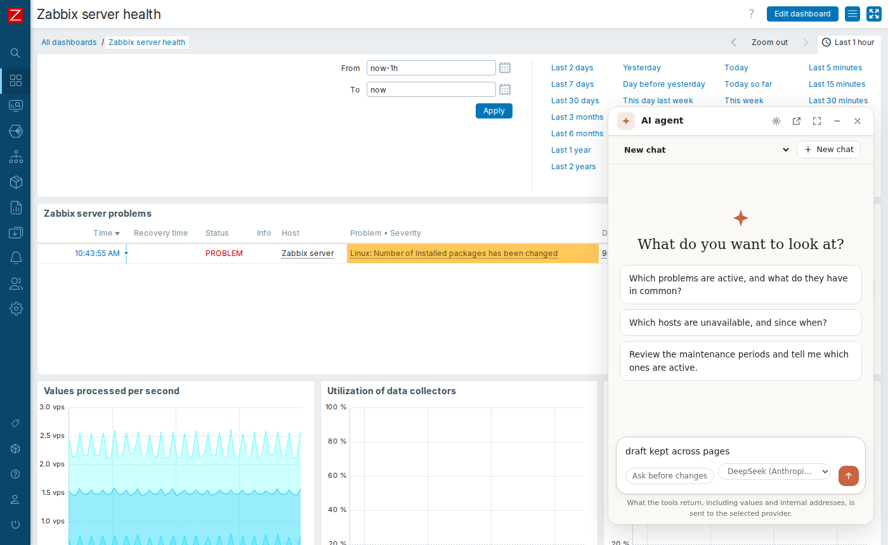
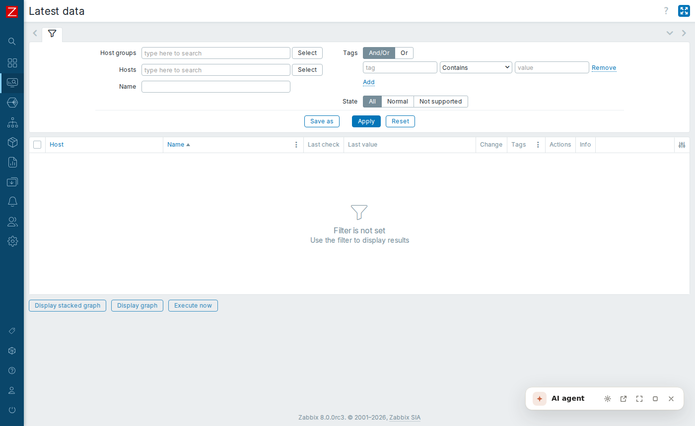
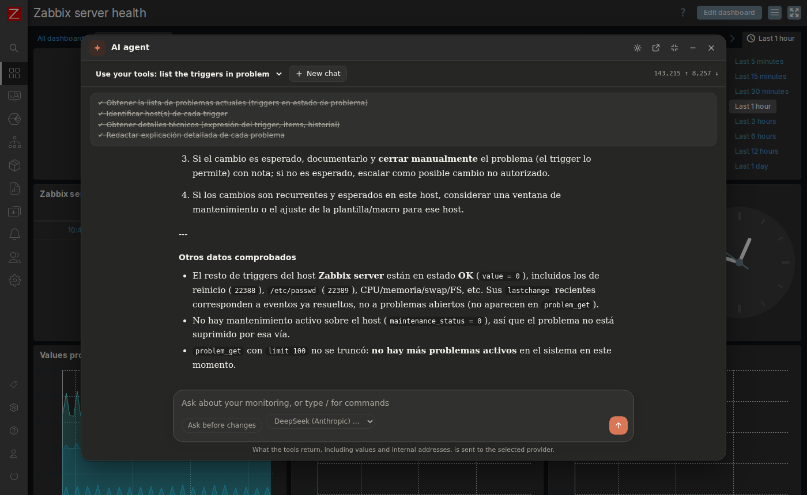
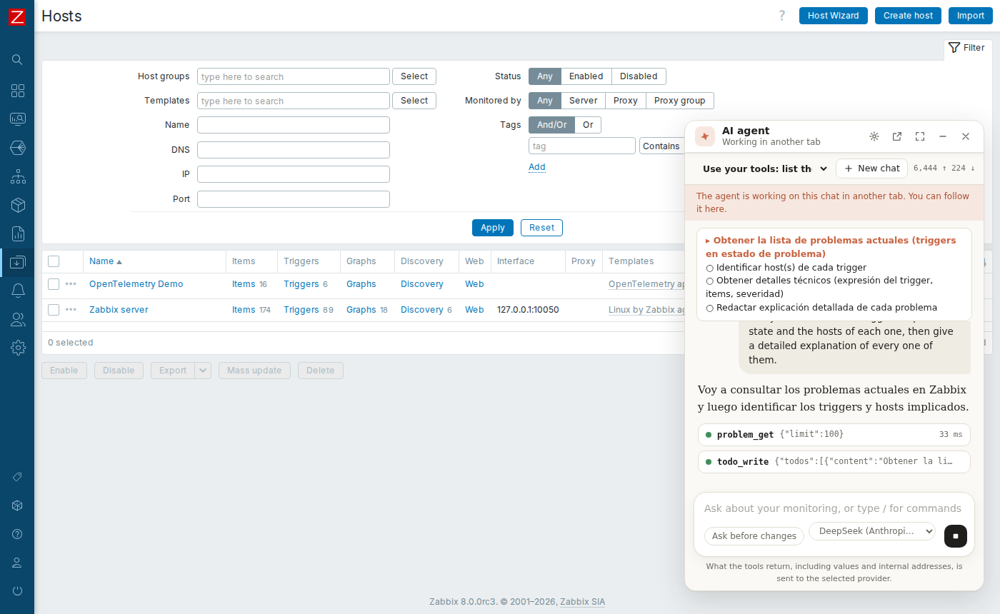
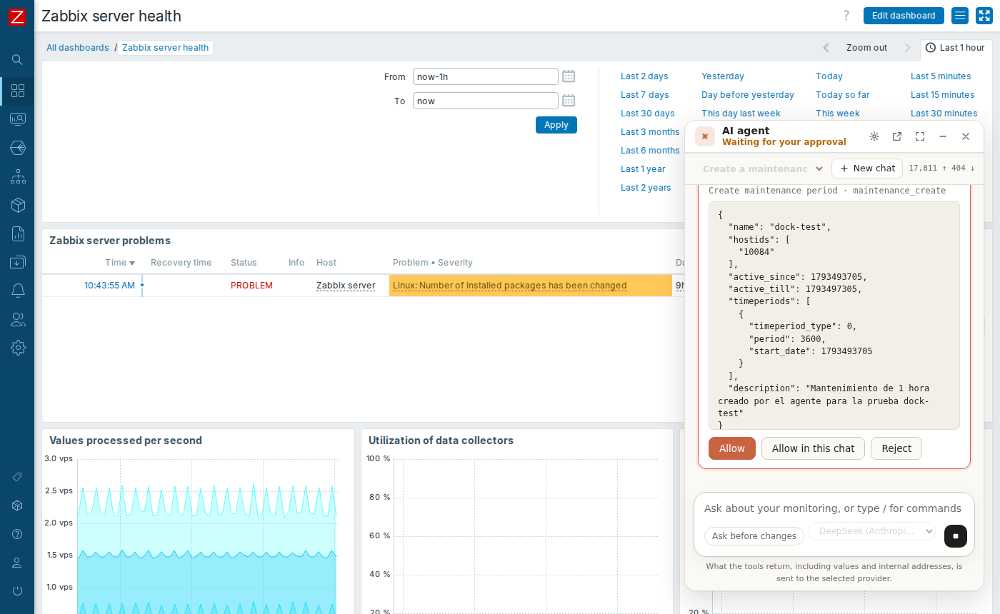
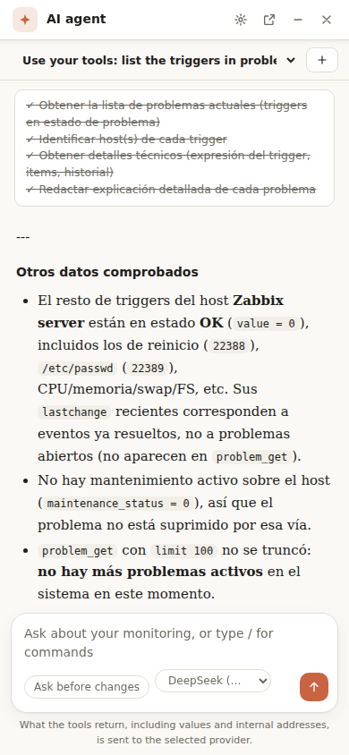
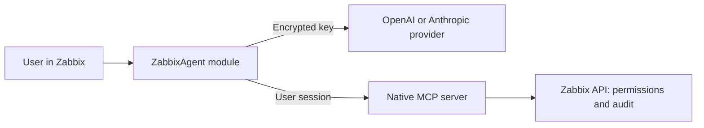

# Zabbix MCP Agent

**Talk to your Zabbix: an AI agent that investigates, proposes and acts with your approval, using the native MCP server.**

English · [Español](README.es.md)

**[🚀 Install step by step](docs/ubuntu-step-by-step.md)** · [What it does](#what-it-does) · [How it works](#how-it-works) · [Security](#security) · [What was tested](#what-was-tested)

A frontend module for Zabbix 8 that adds an agentic chat **floating on every page**: a button in the corner opens it minimized, normal or wide, and it stays open and keeps working while you move between sections. It works with the permissions of each user, and with any provider compatible with OpenAI or Anthropic (Claude).

> [!WARNING]
> **Early version.** It depends on Zabbix 8.0.0rc3, a release candidate. What the tools return is sent to the AI provider you choose.

## 🚀 Install it step by step

> [!IMPORTANT]
> ### [Open the guide: AI agent for Zabbix 8 on Ubuntu →](docs/ubuntu-step-by-step.md)
>
> It installs the MCP server and the module, connects a provider and checks the approvals, with the commands that were run and the problems found. Also in [Spanish](docs/guia-ubuntu-paso-a-paso.md).

| Step | What you do | How you know it worked |
|---|---|---|
| **1-3** | Install and configure the official MCP server | `---- MCP server is working` |
| **4** | Install and enable the module | The chat button appears in the lower-right corner |
| **5** | Connect your AI provider | `It works: <model>` |
| **6** | Try the agent and the approvals | A rejection changes nothing; what you approve is audited |

## What it does

| Feature | Detail |
|---|---|
| **Always at hand** | Floating button on every page. **Minimized**, **normal** or **wide**, and `Ctrl+.` to open or close it |
| **Keeps going when you navigate** | Change section or module: the chat stays as it was, and an answer in progress goes on in the next page |
| **Several tabs** | One tab runs the agent; the others follow it live and can stop it |
| **Investigates on its own** | Chains tools: problems, hosts, triggers, items and history |
| **Asks for approval** | Shows what will change, and does it only if you allow it |
| **Three modes** | *Ask*, *Plan* (read only) and *Auto*. Switch with `Shift+Tab` |
| **Shows its work** | Streaming answer, reasoning, collapsible calls and a task list |
| **Asks you** | When it needs a decision, it waits for your answer |
| **Driven like a terminal** | `/help`, `/clear`, `/compact`, `/mode`, `/model`, `/tools`, `/sessions`, `/forget` and **Stop** |
| **Manages context** | Summarizes the conversation near the limit |
| **Several providers** | OpenAI-compatible and Anthropic-compatible profiles, and switching between them |

| Normal, next to Zabbix | Minimized | Dark theme |
|---|---|---|
|  |  |  |
| **Another tab follows it live** | **Waiting for your approval** | **Phone** |
|  |  |  |

**Tools of the MCP server:** 12 read and 10 change: acknowledge, comment, change severity, suppress or close problems, and create, edit or delete maintenance periods.

## How it works

The browser drives the agent loop, and the module's server side is the intermediary with the provider and MCP. The [guide](docs/ubuntu-step-by-step.md#how-it-works) has the details.

## Security

- **No shared token:** each user acts with their session. They only see what Zabbix allows them, and changes are audited under their name.
- **Approval on the server:** a tool not declared read-only doesn't run without approval, and never in plan mode.
- **Encrypted keys:** AES-256-GCM, with the key file outside the web root. They never reach the browser.
- **No executable content:** all text is escaped before it is shown.

Read the [risks and responsibilities](docs/ubuntu-step-by-step.md#security), especially which data goes to the AI and prompt injection.

## What was tested

| Test | Result |
|---|---|
| Guide run with its own commands | Ubuntu 26.10 ARM64, Zabbix 8.0.0rc3 built from source |
| Real conversations | DeepSeek on its OpenAI-compatible and Anthropic-compatible APIs, with real data |
| Real browser (Chromium) | Streaming, tools, approve and reject, plan, stop, `/compact`, mobile and an HTML injection attempt |
| Floating chat (Chromium) | Three sizes, `Ctrl+.` and `Esc`; stays open across sections; an answer goes on after changing page; an approval comes back after changing page and a rejection changes nothing; a second tab follows in read only and takes over when the first closes; phone; no dock in kiosk mode |
| Permissions | A user without access gets the API error, and can't open the settings |
| Tests and CI | Message conversion, streams, encryption and translations |

> [!NOTE]
> **Not tested:** AMD64, Ubuntu 26.04, Zabbix from packages, Apache, and the own APIs of OpenAI and Anthropic. The Spanish interface wasn't seen on screen, and the dark theme was seen by switching the stylesheet, not with the user setting. The floating chat was tested with its new assets and `agent.config` served from the working copy, before installing them on the server.

## What's included

| Path | What it is |
|---|---|
| `modules/ZabbixAgent` | The module |
| `scripts/install.sh`, `scripts/enable-module.py` | Install and enable the module |
| `scripts/verify-mcp.py` | Checks the MCP server |
| `tests/run.php` | Tests that don't need Zabbix |

## License

[AGPL-3.0](LICENSE), the license of Zabbix itself. © Simon Alex Rodriguez.
