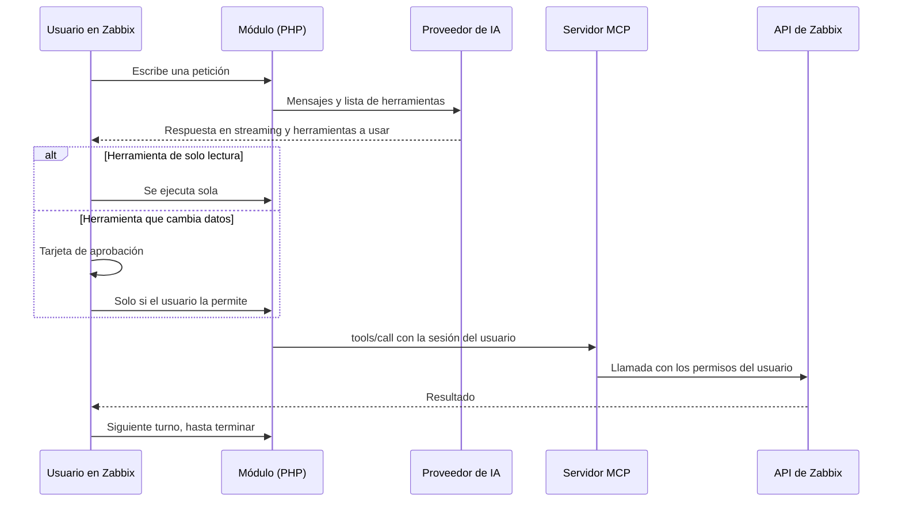
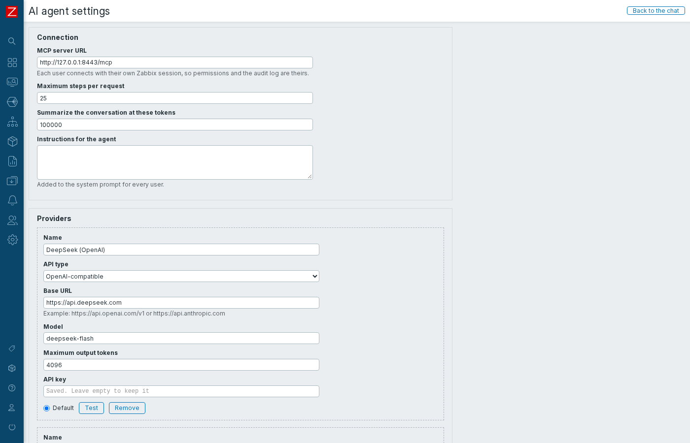
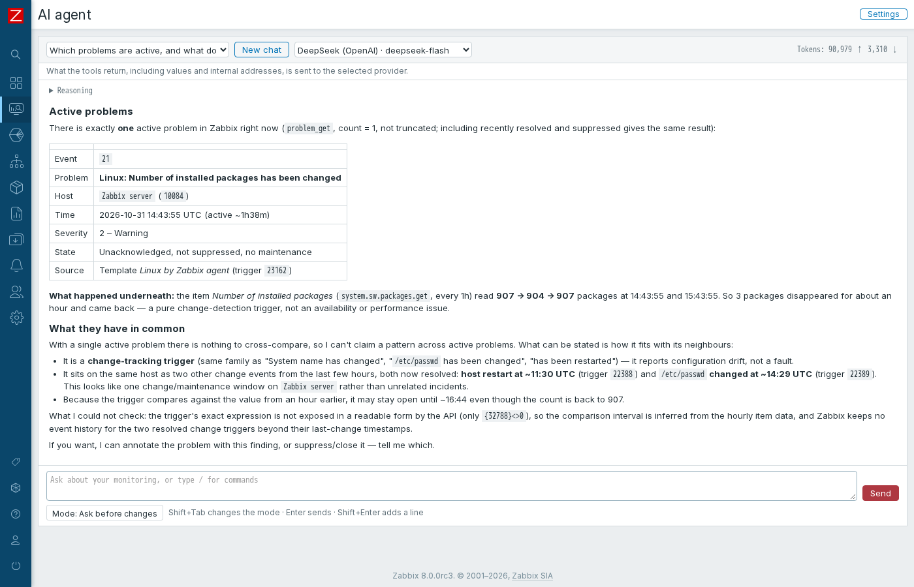
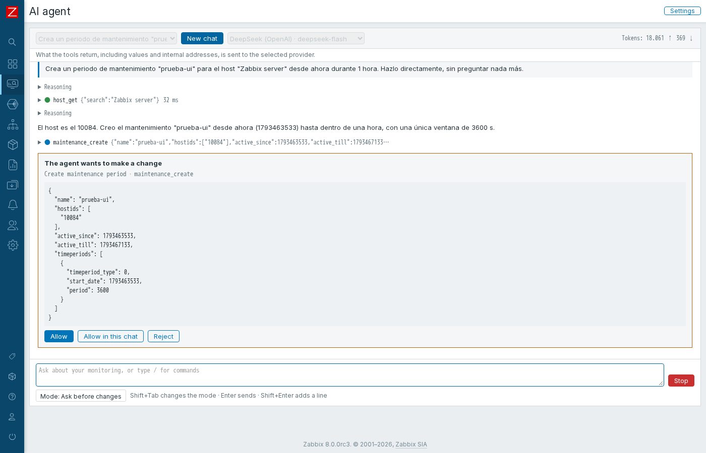

# Agente de IA para Zabbix 8 en Ubuntu, paso a paso

[English](ubuntu-step-by-step.md)

Esta guía parte de un Ubuntu con **Zabbix 8** y termina con un chat agéntico dentro de Zabbix, conectado a su **servidor MCP nativo** y a un proveedor de IA.

Sigue los pasos **en orden** y **en la misma terminal**, porque las variables de un paso se usan en el siguiente.

## Cómo funciona



| Pieza | Qué hace |
|---|---|
| **Servidor MCP** (`zabbix_mcp_server`) | Programa oficial de Zabbix. Traduce herramientas MCP a la API. Escucha en `127.0.0.1:8443`, sin estado |
| **Módulo** (`ZabbixAgent`) | Interfaz de chat, bucle del agente y conexión con los proveedores. Guarda las claves cifradas |
| **Proveedor de IA** | Cualquier API compatible con OpenAI o con Anthropic (Claude) |

**Cada usuario actúa con su propia sesión de Zabbix.** No hay un token compartido: el agente solo ve lo que ese usuario puede ver, y los cambios quedan en la auditoría a su nombre.

> [!IMPORTANT]
> **El servidor MCP aplica los cambios sin preguntar** si su cliente no soporta elicitación de formularios. El módulo no la declara y **hace cumplir su propia aprobación en el servidor**: una herramienta que no se declare de solo lectura no se ejecuta sin aprobación, ni nunca en modo plan.

### Qué se comprobó

Se ejecutó en un server con Ubuntu 26.10 ARM64, Zabbix 8.0.0rc3 compilado desde fuente, Nginx y PHP 8.5. Los proveedores probados fueron DeepSeek en sus dos API, compatible con OpenAI y con Anthropic.

> [!WARNING]
> **No se comprobó** en AMD64, en Ubuntu 26.04, con Zabbix instalado por paquetes, con Apache, ni con las API propias de OpenAI o Anthropic. La interfaz en español tampoco se vio en pantalla: sus traducciones están cubiertas por los tests. RC3 no es apta para producción.

## Antes de empezar

| Necesitas | Cómo conseguirlo |
|---|---|
| **Zabbix 8 funcionando** | Por ejemplo, con [esta guía](https://github.com/SimonLexRS/Zabbix-8-rc3-Instalacion) |
| **Acceso con `sudo`** | Tu usuario administrador |
| **Token de API de un Super admin** | Zabbix: **User settings → API tokens** |
| **Clave de un proveedor de IA** | La cargas en la web, en el paso 5 |

## Paso 0. Definir tus datos

Cambia la dirección de tu Zabbix si hace falta, y pega el token cuando lo pida; no se mostrará:

```sh
export ZABBIX_URL=http://127.0.0.1
read -rs ZABBIX_API_TOKEN && export ZABBIX_API_TOKEN
curl -s -H 'Content-Type: application/json-rpc' -d '{"jsonrpc":"2.0","method":"apiinfo.version","params":{},"id":1}' "$ZABBIX_URL/api_jsonrpc.php"; echo
```

✅ **Debes ver** `"result":"8.0.0"`. RC3 también responde así.

## Paso 1. Descargar el repositorio

```sh
sudo apt-get install -y git curl python3
mkdir -p ~/Devs && cd ~/Devs
[ -d zabbix-mcp ] || git clone https://github.com/SimonLexRS/zabbix-mcp.git
cd ~/Devs/zabbix-mcp
```

## Paso 2. Instalar el servidor MCP

**Por qué así:** Zabbix publica el paquete RC3 en su repositorio `unstable` hasta Ubuntu 26.04. El programa solo depende de `lsb-base`, así que el mismo `.deb` funcionó en 26.10. La verificación compara el archivo con el índice del repositorio:

```sh
ARCH=$(dpkg --print-architecture)
V='8.0.0~rc3-1+ubuntu26.04'
F="zabbix-mcp-server_${V}_${ARCH}.deb"
REPO=https://repo.zabbix.com/zabbix/8.0/unstable/ubuntu
curl -fsSL -o "/tmp/$F" "$REPO/pool/main/z/zabbix-mcp-server/$F"
EXPECTED=$(curl -fsSL "$REPO/dists/resolute/main/binary-$ARCH/Packages.gz" | gunzip | awk -v f="$F" '$1=="Filename:" && index($2,f){ok=1} ok && $1=="SHA256:"{print $2; exit}')
echo "$EXPECTED  /tmp/$F" | sha256sum -c -
```

✅ **Debes ver** `OK`. **Si no, no continúes.**

```sh
sudo dpkg -i "/tmp/$F"
rm -f "/tmp/$F"
```

❌ **Es normal que el servicio quede `inactive`:** todavía falta su configuración.

## Paso 3. Configurar el servidor MCP

Escucha solo en `localhost`, porque el módulo corre en el mismo server. Si tu frontend está en otra ruta, corrige `FrontendURL`.

```sh
C=/etc/zabbix/zabbix_mcp_server.conf
sudo sed -i -E 's|^#? *FrontendURL=.*|FrontendURL=http://127.0.0.1/api_jsonrpc.php|; s|^#? *ListenIP=.*|ListenIP=127.0.0.1|' "$C"
```

### ¿Qué herramientas activar?

Por defecto, Zabbix desactiva `item_get`, `lld_get`, `interface_get`, `macro_get` e `history_get`. **Sin ellas, el agente no puede leer métricas.**

> [!CAUTION]
> Todo lo que devuelve una herramienta se envía al proveedor de IA. Valores, logs, macros no secretas e IP internas saldrían de tu red. Evalúalo antes de activarlas. Las macros secretas nunca las devuelve la API.

Este comando las activa todas, como en la instalación de referencia. **Omítelo** si prefieres la opción segura:

```sh
sudo sed -i '/^DenyTool=/d' "$C"
```

Arranca y comprueba:

```sh
sudo zabbix_mcp_server -c "$C" -T
sudo systemctl enable zabbix-mcp-server
sudo systemctl restart zabbix-mcp-server
sleep 3
systemctl is-active zabbix-mcp-server
ss -tln | grep ':8443 '
python3 scripts/verify-mcp.py
```

✅ **Debes ver** `active`, el puerto solo en `127.0.0.1` y:

```text
OK   22 tools: 12 read, 10 change
OK   real read through the Zabbix API (hostgroup_get)
---- MCP server is working
```

Con la opción segura, verás 17 herramientas.

## Paso 4. Instalar el módulo

El script detecta el frontend y crea `/etc/zabbix/zabbix-agent-module.key`, la llave que cifra las claves de los proveedores. Solo root y el grupo `www-data` pueden leerla:

```sh
sudo ./scripts/install.sh
python3 scripts/enable-module.py
```

✅ **Debes ver** `Installed in .../modules/ZabbixAgent` y `ZabbixAgent: enabled`. El menú tendrá **Monitoring → AI agent**.

❌ **Si el frontend corre con otro usuario o grupo:** `sudo ZABBIX_WEB_GROUP=nginx ./scripts/install.sh`. Si no se encuentra el frontend, agrega `ZABBIX_UI=/ruta/al/frontend`.

## Paso 5. Conectar un proveedor

En Zabbix, entra en **Monitoring → AI agent → Settings → Add provider**, completa los campos, pulsa **Test** y luego **Save**.



| Proveedor | Tipo de API | URL base | Modelo, ejemplo |
|---|---|---|---|
| **DeepSeek** (probado) | OpenAI-compatible | `https://api.deepseek.com` | `deepseek-flash` |
| **DeepSeek** (probado) | Anthropic-compatible | `https://api.deepseek.com/anthropic` | `deepseek-flash` |
| OpenAI (sin probar) | OpenAI-compatible | `https://api.openai.com/v1` | Consulta su documentación |
| Anthropic / Claude (sin probar) | Anthropic-compatible | `https://api.anthropic.com` | Consulta su documentación |
| Ollama, LM Studio u otros (sin probar) | OpenAI-compatible | `http://<host>:<puerto>/v1` | El que tengas cargado |

✅ **Debes ver** `It works: <modelo>` al pulsar **Test**.

## Paso 6. Usar el agente

Abre **Monitoring → AI agent** y pregunta, por ejemplo: `¿Qué problemas están activos y qué tienen en común?`



| Función | Cómo funciona |
|---|---|
| **Streaming** | La respuesta y el razonamiento aparecen mientras se generan |
| **Herramientas visibles** | Cada llamada se puede abrir para ver parámetros, resultado y duración |
| **Aprobación** | Los cambios esperan a **Allow**, **Allow in this chat** o **Reject** |
| **Modos** | `Shift+Tab` alterna: *Preguntar*, *Plan* (solo lectura) y *Auto* (aplica cambios sin preguntar) |
| **Tareas** | El agente muestra y actualiza su lista de tareas |
| **Preguntas** | Si necesita una decisión, te pregunta y espera |
| **Detener** | **Stop** o `Esc` |
| **Contexto** | Resume la conversación al acercarse al límite, o con `/compact` |
| **Comandos** | `/help`, `/clear`, `/compact`, `/mode`, `/model`, `/tools`, `/sessions`, `/forget` |



### Comprobar la aprobación

1. Pide: `Crea un periodo de mantenimiento "prueba" para el host "Zabbix server" durante 1 hora`.
2. Pulsa **Reject**. En **Data collection → Maintenance** no debe aparecer.
3. Pídelo otra vez y pulsa **Allow**. Debe aparecer.
4. En **Reports → Audit log** figura a tu nombre.
5. Bórralo. Pídeselo al agente o hazlo en la web.

## Seguridad

| Tema | Qué hace el módulo | Qué debes hacer tú |
|---|---|---|
| **Claves de proveedores** | AES-256-GCM; nunca llegan al navegador ni a los logs | Respaldar la llave `/etc/zabbix/zabbix-agent-module.key`: sin ella hay que volver a cargarlas |
| **Permisos** | Usa la sesión de cada usuario | Dar a cada rol solo lo necesario. El rol debe permitir el acceso a la API |
| **Cambios** | Aprobación aplicada en el servidor | Leer cada tarjeta. Reservar *Auto* para casos concretos |
| **Datos enviados a la IA** | Lo avisa en la pantalla | Elegir qué herramientas activar y qué proveedor usar |
| **Inyección de prompts** | Indica al modelo que lo devuelto por herramientas son datos | Desconfiar de cambios inesperados: un log puede contener instrucciones maliciosas |
| **Conversaciones** | Se guardan en el `localStorage` de ese navegador | Usar `/forget` en equipos compartidos |
| **Red** | El servidor MCP solo escucha en `localhost` | Si lo separas del frontend, usar TLS y limitar `AllowedIP` |

## Problemas que aparecieron y cómo se resolvieron

| # | Paso | Síntoma | Causa | Solución |
|---|---|---|---|---|
| 1 | 2 | `zabbix-mcp-server` queda `inactive` | Falta configuración obligatoria | Paso 3 |
| 2 | 2 | No hay paquete para Ubuntu 26.10 | El repositorio llega hasta 26.04 | Instalar el `.deb` directamente; funcionó |
| 3 | 3 | El agente no ve métricas | Zabbix desactiva esas herramientas por defecto | Decidir y quitar los `DenyTool` |
| 4 | 5 | `/anthropic/v1/models` responde 404 en DeepSeek | Esa ruta no existe, aunque `/v1/messages` funciona | No afecta: **Test** usa `/v1/messages` |
| 5 | 6 | `No permissions to call "host.get"` | El rol del usuario no permite ese acceso a la API | Es lo correcto: el agente respeta el rol. Ajústalo en **Users → User roles** si debe tenerlo |
| 6 | 6 | `Cannot modify header information` en el log, durante el streaming | La sesión intentaba guardar su cookie al terminar la respuesta | Corregido: se cierra antes de transmitir |
| 7 | 6 | En plan, el agente decía que no existen herramientas de cambio | Solo veía las de lectura | Corregido en sus instrucciones |
| 8 | 6 | Controles fuera de la pantalla en móvil | Ancho de la barra superior | Corregido en los estilos |

## Otros problemas posibles

No ocurrieron en esta prueba:

| Síntoma | Qué revisar |
|---|---|
| `Cannot reach the MCP server: HTTP 403` | Agrega la dirección del frontend a `AllowedIP` |
| `HTTP 401` del proveedor | Revisa la clave en **Settings** |
| `Cannot read /etc/zabbix/zabbix-agent-module.key` | Vuelve a ejecutar `scripts/install.sh`, con `ZABBIX_WEB_GROUP` si hace falta |
| `Cannot decrypt the stored key` | La llave cambió: carga de nuevo las claves |
| El texto aparece de golpe, no en streaming | Un proxy guarda la respuesta. Nginx respeta `X-Accel-Buffering: no`; en Apache, revisa `mod_proxy_fcgi` |
| Se corta una respuesta muy larga | Sube `fastcgi_read_timeout` en Nginx. Aquí se dejó en 600 s |
| **Maximum output tokens** corta las respuestas | Súbelo en **Settings** |

## Actualizar y retirar

```text
git pull && sudo ./scripts/install.sh       # actualizar el módulo
sudo ./scripts/install.sh --uninstall       # retirarlo, tras deshabilitarlo en Modules
sudo dpkg -P zabbix-mcp-server              # retirar el servidor MCP
```

La llave `/etc/zabbix/zabbix-agent-module.key` no se borra sola.
