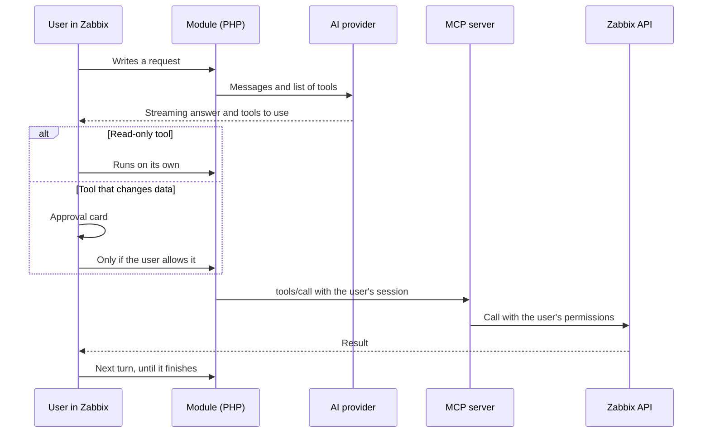
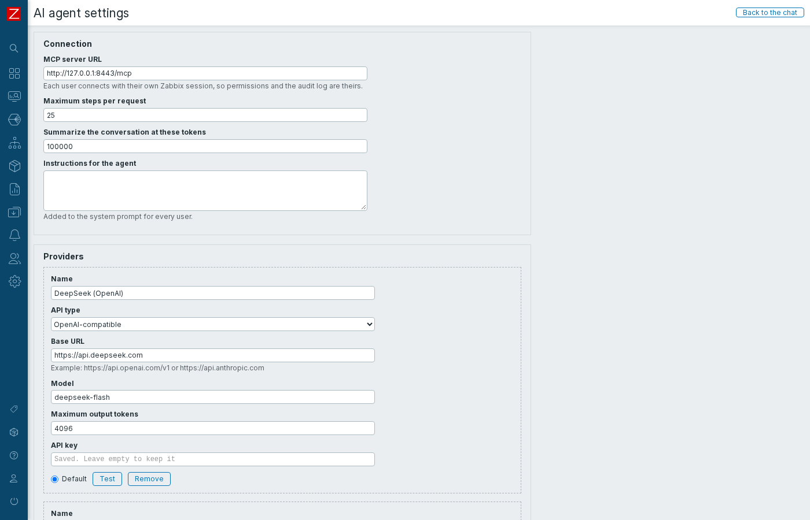
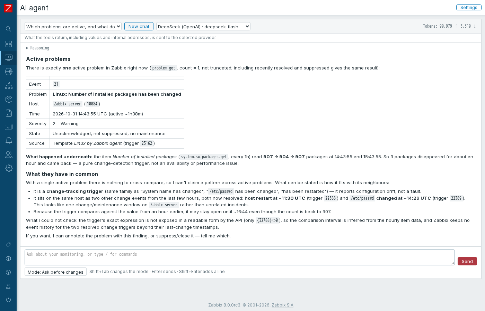
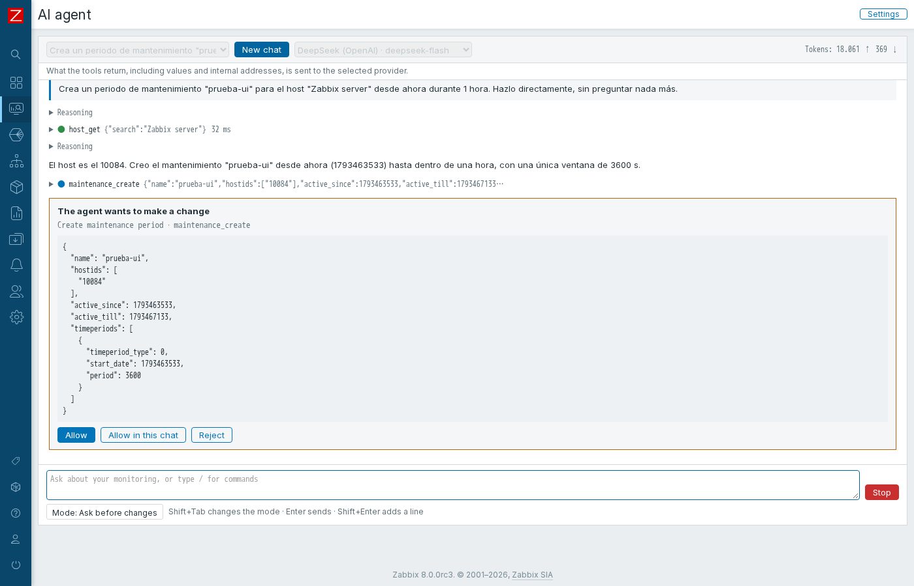

# AI agent for Zabbix 8 on Ubuntu, step by step

[Español](guia-ubuntu-paso-a-paso.md)

This guide starts from an Ubuntu server with **Zabbix 8** and ends with an agentic chat inside Zabbix, connected to its **native MCP server** and to an AI provider.

Follow the steps **in order** and **in the same terminal**, because the variables of one step are used in the next.

## How it works



| Piece | What it does |
|---|---|
| **MCP server** (`zabbix_mcp_server`) | Official Zabbix program. Translates MCP tools to the API. Listens on `127.0.0.1:8443`, stateless |
| **Module** (`ZabbixAgent`) | Chat interface, agent loop and connection with providers. Stores the keys encrypted |
| **AI provider** | Any API compatible with OpenAI or Anthropic (Claude) |

**Each user acts with their own Zabbix session.** There is no shared token: the agent only sees what that user can see, and changes are audited under their name.

> [!IMPORTANT]
> **The MCP server applies changes without asking** when its client doesn't support form elicitation. The module doesn't declare it and **enforces its own approval on the server**: a tool not declared read-only doesn't run without approval, and never in plan mode.

### What was tested

It was run on a server with Ubuntu 26.10 ARM64, Zabbix 8.0.0rc3 built from source, Nginx and PHP 8.5. The tested providers were DeepSeek on both of its APIs, OpenAI-compatible and Anthropic-compatible.

> [!WARNING]
> **Not tested** on AMD64, on Ubuntu 26.04, with Zabbix from packages, with Apache, or with the own APIs of OpenAI or Anthropic. The Spanish interface wasn't seen on screen either: its translations are covered by the tests. RC3 isn't suitable for production.

## Before you start

| You need | How to get it |
|---|---|
| **Zabbix 8 running** | For example, with [this guide](https://github.com/SimonLexRS/Zabbix-8-rc3-Instalacion) (in Spanish) |
| **`sudo` access** | Your administrator user |
| **API token of a Super admin** | Zabbix: **User settings → API tokens** |
| **Key of an AI provider** | You enter it on the web, in step 5 |

## Step 0. Set your data

Change the address of your Zabbix if needed, and paste the token when asked; it won't be shown:

```sh
export ZABBIX_URL=http://127.0.0.1
read -rs ZABBIX_API_TOKEN && export ZABBIX_API_TOKEN
curl -s -H 'Content-Type: application/json-rpc' -d '{"jsonrpc":"2.0","method":"apiinfo.version","params":{},"id":1}' "$ZABBIX_URL/api_jsonrpc.php"; echo
```

✅ **You must see** `"result":"8.0.0"`. RC3 also answers this.

## Step 1. Download the repository

```sh
sudo apt-get install -y git curl python3
mkdir -p ~/Devs && cd ~/Devs
[ -d zabbix-mcp ] || git clone https://github.com/SimonLexRS/zabbix-mcp.git
cd ~/Devs/zabbix-mcp
```

## Step 2. Install the MCP server

**Why this way:** Zabbix publishes the RC3 package in its `unstable` repository up to Ubuntu 26.04. The program only depends on `lsb-base`, so the same `.deb` worked on 26.10. The check compares the file with the repository index:

```sh
ARCH=$(dpkg --print-architecture)
V='8.0.0~rc3-1+ubuntu26.04'
F="zabbix-mcp-server_${V}_${ARCH}.deb"
REPO=https://repo.zabbix.com/zabbix/8.0/unstable/ubuntu
curl -fsSL -o "/tmp/$F" "$REPO/pool/main/z/zabbix-mcp-server/$F"
EXPECTED=$(curl -fsSL "$REPO/dists/resolute/main/binary-$ARCH/Packages.gz" | gunzip | awk -v f="$F" '$1=="Filename:" && index($2,f){ok=1} ok && $1=="SHA256:"{print $2; exit}')
echo "$EXPECTED  /tmp/$F" | sha256sum -c -
```

✅ **You must see** `OK`. **If not, don't continue.**

```sh
sudo dpkg -i "/tmp/$F"
rm -f "/tmp/$F"
```

❌ **It's normal for the service to stay `inactive`:** its configuration is still missing.

## Step 3. Configure the MCP server

It listens only on `localhost`, because the module runs on the same server. If your frontend is on another path, fix `FrontendURL`.

```sh
C=/etc/zabbix/zabbix_mcp_server.conf
sudo sed -i -E 's|^#? *FrontendURL=.*|FrontendURL=http://127.0.0.1/api_jsonrpc.php|; s|^#? *ListenIP=.*|ListenIP=127.0.0.1|' "$C"
```

### Which tools to enable?

By default, Zabbix disables `item_get`, `lld_get`, `interface_get`, `macro_get` and `history_get`. **Without them, the agent can't read metrics.**

> [!CAUTION]
> Everything a tool returns is sent to the AI provider. Values, logs, non-secret macros and internal IPs would leave your network. Assess this before enabling them. The API never returns secret macros.

This command enables them all, as in the reference installation. **Skip it** if you prefer the safe option:

```sh
sudo sed -i '/^DenyTool=/d' "$C"
```

Start and check:

```sh
sudo zabbix_mcp_server -c "$C" -T
sudo systemctl enable zabbix-mcp-server
sudo systemctl restart zabbix-mcp-server
sleep 3
systemctl is-active zabbix-mcp-server
ss -tln | grep ':8443 '
python3 scripts/verify-mcp.py
```

✅ **You must see** `active`, the port only on `127.0.0.1` and:

```text
OK   22 tools: 12 read, 10 change
OK   real read through the Zabbix API (hostgroup_get)
---- MCP server is working
```

With the safe option, you'll see 17 tools.

## Step 4. Install the module

The script finds the frontend and creates `/etc/zabbix/zabbix-agent-module.key`, the key that encrypts the provider keys. Only root and the `www-data` group can read it:

```sh
sudo ./scripts/install.sh
python3 scripts/enable-module.py
```

✅ **You must see** `Installed in .../modules/ZabbixAgent` and `ZabbixAgent: enabled`. The menu will have **Monitoring → AI agent**.

❌ **If the frontend runs under another user or group:** `sudo ZABBIX_WEB_GROUP=nginx ./scripts/install.sh`. If the frontend isn't found, add `ZABBIX_UI=/path/to/frontend`.

## Step 5. Connect a provider

In Zabbix, go to **Monitoring → AI agent → Settings → Add provider**, fill in the fields, press **Test** and then **Save**.



| Provider | API type | Base URL | Model, example |
|---|---|---|---|
| **DeepSeek** (tested) | OpenAI-compatible | `https://api.deepseek.com` | `deepseek-flash` |
| **DeepSeek** (tested) | Anthropic-compatible | `https://api.deepseek.com/anthropic` | `deepseek-flash` |
| OpenAI (not tested) | OpenAI-compatible | `https://api.openai.com/v1` | See its documentation |
| Anthropic / Claude (not tested) | Anthropic-compatible | `https://api.anthropic.com` | See its documentation |
| Ollama, LM Studio or others (not tested) | OpenAI-compatible | `http://<host>:<port>/v1` | The one you have loaded |

✅ **You must see** `It works: <model>` when you press **Test**.

## Step 6. Use the agent

Open **Monitoring → AI agent** and ask, for example: `Which problems are active, and what do they have in common?`



| Feature | How it works |
|---|---|
| **Streaming** | The answer and the reasoning appear as they are generated |
| **Visible tools** | Each call can be opened to see parameters, result and duration |
| **Approval** | Changes wait for **Allow**, **Allow in this chat** or **Reject** |
| **Modes** | `Shift+Tab` switches: *Ask*, *Plan* (read only) and *Auto* (applies changes without asking) |
| **Tasks** | The agent shows and updates its task list |
| **Questions** | When it needs a decision, it asks and waits |
| **Stop** | **Stop** or `Esc` |
| **Context** | Summarizes the conversation near the limit, or with `/compact` |
| **Commands** | `/help`, `/clear`, `/compact`, `/mode`, `/model`, `/tools`, `/sessions`, `/forget` |



### Check the approval

1. Ask: `Create a maintenance period "test" for the host "Zabbix server" for 1 hour`.
2. Press **Reject**. It must not appear in **Data collection → Maintenance**.
3. Ask again and press **Allow**. It must appear.
4. **Reports → Audit log** shows it under your name.
5. Delete it. Ask the agent, or do it on the web.

## Security

| Topic | What the module does | What you should do |
|---|---|---|
| **Provider keys** | AES-256-GCM; they never reach the browser or the logs | Back up `/etc/zabbix/zabbix-agent-module.key`: without it, you must enter them again |
| **Permissions** | Uses each user's session | Give each role only what it needs. The role must allow API access |
| **Changes** | Approval enforced on the server | Read each card. Keep *Auto* for specific cases |
| **Data sent to the AI** | Warns about it on screen | Choose which tools to enable and which provider to use |
| **Prompt injection** | Tells the model that tool output is data | Distrust unexpected changes: a log can contain malicious instructions |
| **Conversations** | Kept in that browser's `localStorage` | Use `/forget` on shared computers |
| **Network** | The MCP server only listens on `localhost` | If you move it away from the frontend, use TLS and limit `AllowedIP` |

## Problems that appeared and how they were solved

| # | Step | Symptom | Cause | Solution |
|---|---|---|---|---|
| 1 | 2 | `zabbix-mcp-server` stays `inactive` | Mandatory configuration is missing | Step 3 |
| 2 | 2 | No package for Ubuntu 26.10 | The repository goes up to 26.04 | Install the `.deb` directly; it worked |
| 3 | 3 | The agent doesn't see metrics | Zabbix disables those tools by default | Decide, and remove the `DenyTool` lines |
| 4 | 5 | `/anthropic/v1/models` answers 404 on DeepSeek | That path doesn't exist, although `/v1/messages` works | No effect: **Test** uses `/v1/messages` |
| 5 | 6 | `No permissions to call "host.get"` | The user's role doesn't allow that API access | That's correct: the agent respects the role. Adjust it in **Users → User roles** if it should have it |
| 6 | 6 | `Cannot modify header information` in the log, while streaming | The session tried to save its cookie at the end of the response | Fixed: it closes before streaming |
| 7 | 6 | In plan mode, the agent said there were no change tools | It only saw the read ones | Fixed in its instructions |
| 8 | 6 | Controls off screen on mobile | Width of the top bar | Fixed in the styles |

## Other possible problems

These did not happen in this test:

| Symptom | What to check |
|---|---|
| `Cannot reach the MCP server: HTTP 403` | Add the frontend address to `AllowedIP` |
| `HTTP 401` from the provider | Check the key in **Settings** |
| `Cannot read /etc/zabbix/zabbix-agent-module.key` | Run `scripts/install.sh` again, with `ZABBIX_WEB_GROUP` if needed |
| `Cannot decrypt the stored key` | The key file changed: enter the keys again |
| Text appears all at once, not streaming | A proxy buffers the response. Nginx respects `X-Accel-Buffering: no`; on Apache, check `mod_proxy_fcgi` |
| A very long response is cut | Raise `fastcgi_read_timeout` in Nginx. It was left at 600 s here |
| **Maximum output tokens** cuts the answers | Raise it in **Settings** |

## Upgrade and remove

```text
git pull && sudo ./scripts/install.sh       # upgrade the module
sudo ./scripts/install.sh --uninstall       # remove it, after disabling it in Modules
sudo dpkg -P zabbix-mcp-server              # remove the MCP server
```

The key file `/etc/zabbix/zabbix-agent-module.key` isn't deleted automatically.
